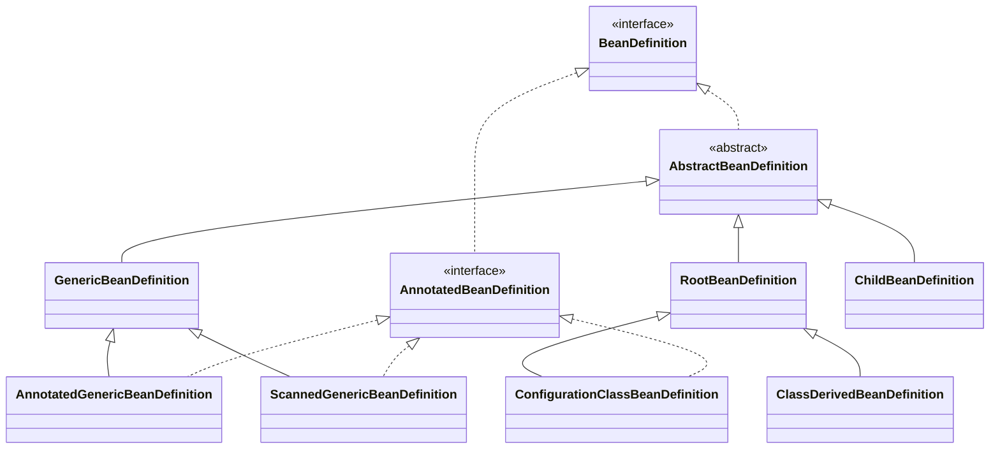

# spring获取bean的元信息


```text
BeanDefinition 的主要子类及使用场景

类层次结构

BeanDefinition (接口)
├── AbstractBeanDefinition (抽象基类)
│   ├── GenericBeanDefinition         ← 最通用，Spring 2.5+ 默认
│   ├── ChildBeanDefinition           ← 已废弃，Spring 2.5 后很少用
│   └── RootBeanDefinition           ← 合并后的"最终形态"
├── AnnotatedBeanDefinition (接口)
│   ├── AnnotatedGenericBeanDefinition ← @Configuration 中 @Bean 方法
│   └── ScannedGenericBeanDefinition  ← @ComponentScan 扫描到的类
├── ConfigurationClassBeanDefinition   ← 仅标记 @Bean 来源（轻量包装）
└── GenericApplicationContext — 内部使用
```

## 类型层次



## 实际开发中的对应关系


```text
1. GenericBeanDefinition（通用注册，首选）
场景： Spring 2.5 之后，注册 Bean 定义时的首选类型。

XML 解析（BeanDefinitionReaderUtils.createBeanDefinition()）
编程式注册（BeanDefinitionBuilder.genericBeanDefinition()）
Properties / Groovy DSL 加载
需要动态设置父 Bean（setParentName()）时
特点：父 Bean 关系通过字符串 parentName 表达，可被 BeanFactoryPostProcessor 修改，适合「配置阶段」的 Bean 定义。


2. RootBeanDefinition（运行时合并 + 框架内部）
场景： 两类用途：

用途	说明
运行时合并结果
AbstractBeanFactory.getMergedBeanDefinition() 将父子定义合并后，得到 RootBeanDefinition，供实例化、依赖注入使用
框架内部直接注册
Namespace Handler、WebSocket 配置等内部模块直接 new RootBeanDefinition(...)
特点：包含大量运行时缓存（targetType、factoryMethodToIntrospect、resolvedConstructorOrFactoryMethod 等），是容器真正用来创建 Bean 的「最终定义」。


3. ChildBeanDefinition（继承父定义，已过时）
场景： 早期 XML 中 <bean parent="parentBean"> 的固定父子继承模型。

子定义继承父的构造参数、属性值、方法覆盖
子定义固定覆盖：depends-on、autowire 模式、singleton、lazy-init 等
自 Spring 2.5 起，GenericBeanDefinition.setParentName() 已基本取代它，保留主要是为了向后兼容。


注解驱动相关
4. AnnotatedBeanDefinition（接口，非实现类）
场景： 需要访问注解元数据（AnnotationMetadata），且不必提前加载 Class 时使用。

扩展了 BeanDefinition，提供：
getMetadata() — 类上的注解信息
getFactoryMethodMetadata() — @Bean 工厂方法的注解信息


5. ScannedGenericBeanDefinition（组件扫描）
场景： @ComponentScan / ClassPathBeanDefinitionScanner 扫描到的类。

基于 ASM MetadataReader 解析 .class，不提前加载 Class
语义上表示「通过扫描发现」的 Bean
供 AutowiredAnnotationBeanPostProcessor、CommonAnnotationBeanPostProcessor 等读取 @Autowired、@Value 等注解


6. AnnotatedGenericBeanDefinition（手动注册带注解的类）
场景：
AnnotatedBeanDefinitionReader.register(MyConfig.class) 手动注册
测试代码中模拟 AnnotatedBeanDefinition
已有 Class 或 AnnotationMetadata 时构造
与 ScannedGenericBeanDefinition 功能相近，但语义是「手动/其他方式注册」，而非扫描发现。


7. ConfigurationClassBeanDefinition（@Configuration + @Bean）
场景： 解析 @Configuration 类中 @Bean 方法时，由 ConfigurationClassBeanDefinitionReader 创建（内部类）。

继承 RootBeanDefinition，同时实现 AnnotatedBeanDefinition
持有 @Bean 工厂方法的 MethodMetadata
标记「来自配置类」，用于 Bean 覆盖（override）判断


8. ClassDerivedBeanDefinition（registerBean(Class)）
场景： GenericApplicationContext.registerBean(Class) 时使用的内部标记子类。

继承 RootBeanDefinition
重写 getPreferredConstructors()，支持 public 构造器或 @Autowired 构造器的灵活自动装配
```